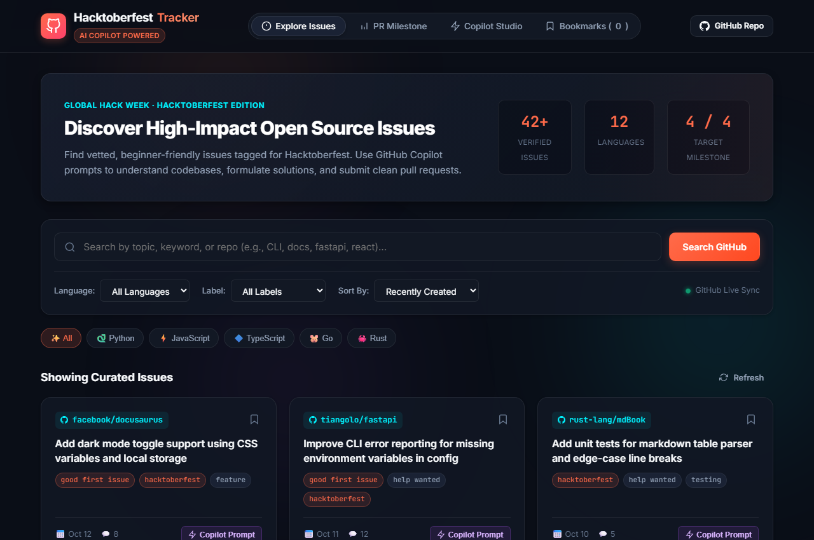
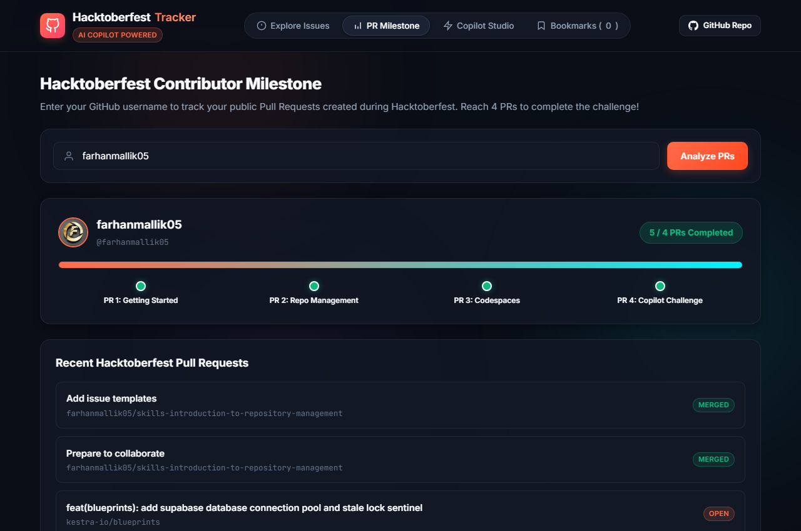
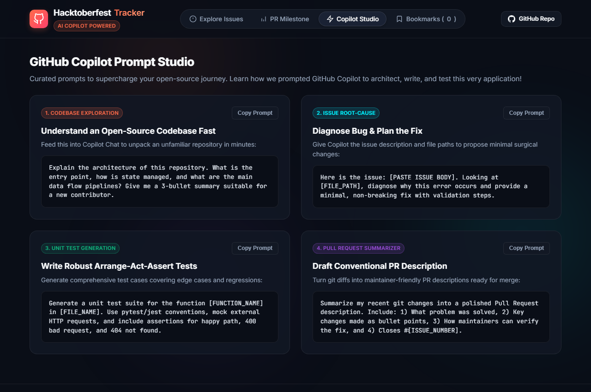

# 🚀 Hacktoberfest Issue Tracker & Contributor Dashboard

[](LICENSE)
[](https://github.com/features/copilot)
[](https://hacktoberfest.com)

A modern, responsive open-source dashboard and CLI companion built with **GitHub Copilot** for **MLH Global Hack Week: Hacktoberfest 2026**.

The application helps developers discover beginner-friendly issues (`good first issue`, `hacktoberfest`, `help wanted`), track their progress towards the 4-PR Hacktoberfest milestone, and leverage structured GitHub Copilot prompts to accelerate open-source contributions.

---

## ✨ Features

- **🔍 Live Issue Discovery**: Search and filter vetted open-source issues across Python, JavaScript, TypeScript, Go, Rust, Java, and more.
- **🛡️ Rate-Limit Resilient**: Real-time GitHub Search API integration paired with curated offline fallback data to guarantee 100% uptime.
- **📊 Contributor Milestone Tracker**: Track any GitHub username's pull requests during Hacktoberfest, visualizing progress towards the 4-PR goal.
- **🤖 Built-in Copilot Studio**: Pre-engineered prompt templates for codebase onboarding, bug diagnosis, unit test generation, and Pull Request summaries.
- **⚡ Prompt Generator Modal**: Click "Copilot Prompt" on any issue to generate a tailored, ready-to-paste prompt for GitHub Copilot Chat in VS Code.
- **📌 Bookmarking**: Save issues locally with single-click bookmarking.
- **💻 CLI Companion (`tracker.py`)**: Zero-dependency Python CLI tool for terminal users to search issues and inspect PR milestones directly in their shell.

---

## 📸 Screenshots

### 1. Issue Explorer & Copilot Integration


### 2. Hacktoberfest Milestone Tracker


### 3. Copilot Prompt Studio


---

## 🛠️ Tech Stack

- **Frontend**: Semantic HTML5, Vanilla JavaScript (ES6+), Vanilla CSS (Custom Design System, Glassmorphism, Responsive Grid).
- **CLI Companion**: Python 3 standard library (`urllib.request`, `json`, `argparse`).
- **APIs**: GitHub REST Search API (`/search/issues`).
- **AI Tooling**: GitHub Copilot (Scaffolding, CSS tokens, API client, prompt engineering).

---

## 🚀 Quick Start

### 1. Web Dashboard
Simply open `index.html` in your web browser:
```bash
# On Windows PowerShell
Start-Process index.html

# Or serve via Python HTTP server
python -m http.server 8080
```
Then visit `http://localhost:8080` in your browser.

### 2. Python CLI Companion
```bash
# Display help and available options
python tracker.py --help

# Search Python issues tagged with hacktoberfest
python tracker.py --language python --limit 5

# Search issues with a custom keyword
python tracker.py --query "documentation" --limit 3

# Generate a GitHub Copilot prompt for the top issue
python tracker.py --language rust --copilot

# Check Hacktoberfest PR progress for a GitHub username
python tracker.py --user farhanmallik05
```

### 3. Run Unit Tests
```bash
python -m unittest test_tracker.py
```

---

## 🤖 GitHub Copilot Prompting Workflow

For full prompt logs and development methodology, see [COPILOT_PROMPTS.md](COPILOT_PROMPTS.md).

Example prompt used to generate the issue solution workflow:
```
I am contributing to the open-source repository {repository} for Hacktoberfest.
Issue Title: "{issue_title}"
URL: {issue_url}

Please provide:
1. Architectural analysis of the relevant files in the repository
2. Minimal, non-breaking code changes needed
3. Automated unit tests using Arrange-Act-Assert
4. A conventional git commit message and Pull Request description
```

---

## 📄 License

This project is licensed under the [MIT License](LICENSE).
